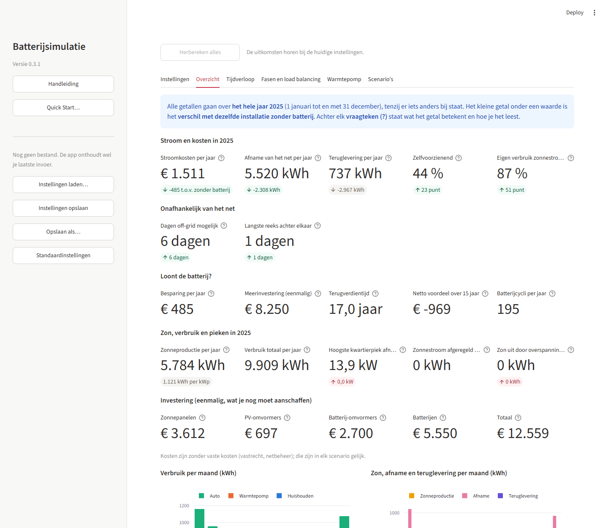
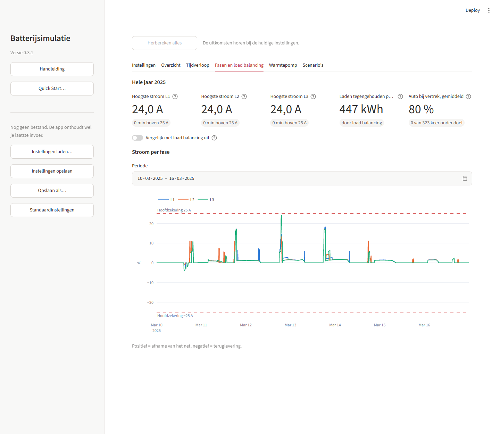

# Batterijsimulatie

Rekent door wat een thuisbatterij, zonnepanelen, een warmtepomp en een
elektrische auto samen doen op een driefasige huisaansluiting, met het echte
weer en de echte stroomprijzen van een jaar uit het verleden. Het antwoord op
de vraag: **loont een batterij bij mij, en welke dan?**

[](https://github.com/jdderijke/Batterij/releases/latest/download/Batterij.zip)
[](https://github.com/jdderijke/Batterij/releases/latest)
[](LICENSE)

De knop geeft altijd de nieuwste versie; het versienummer hiernaast volgt
vanzelf de laatste [release](https://github.com/jdderijke/Batterij/releases),
waar ook staat wat er per versie veranderd is. In de app staat het
versienummer linksboven in de zijbalk.

*Batterij.zip, ongeveer 90 MB. Python installeren is niet nodig. Zie
[Installeren op Windows](#installeren-op-windows).*



## Inhoud

- [Wat de simulatie doet](#wat-de-simulatie-doet)
- [Installeren op Windows](#installeren-op-windows)
- [Handleiding](#handleiding)
- [Voor ontwikkelaars](#voor-ontwikkelaars)
- [Licentie](#licentie)

## Wat de simulatie doet

De simulatie loopt een heel jaar door in stappen van 1 tot 60 minuten. In
elke stap maakt ze per fase de balans op: wat het huis verbruikt, wat de
panelen opwekken, wat de batterij doet en wat er dan over de hoofdaansluiting
loopt. Dezelfde berekening draait ook een keer **zonder batterij**; het
verschil tussen die twee is wat de batterij oplevert.

**Echte data.** Temperatuur en zonnestraling komen uit de uurgegevens van het
[KNMI](https://www.daggegevens.knmi.nl/klimatologie/uurgegevens) (veertien
stations, 2019 tot en met vorig jaar). De uurprijzen komen van de
day-ahead-markt voor Nederland, via
[energy-charts.info](https://api.energy-charts.info) (Fraunhofer ISE). Beide
bronnen zijn openbaar. De app haalt de data één keer op en bewaart ze; daarna
werkt dat jaar ook zonder internet.

**Onbalansprijzen.** Alleen voor de strategie *handel op de onbalansmarkt*
zijn de onbalansprijzen (verrekenprijzen) van TenneT nodig, per kwartier. Die
kan de app niet zelf ophalen: TenneT geeft ze alleen via een download met de
hand of via een API met een persoonlijke sleutel. Ze worden daarom
meegeleverd, voor 2021 tot en met 2025: de map `onbalans/` bevat per jaar het
bestand zoals het van de
[downloadpagina van TenneT](https://www.tennet.eu/nl/de-elektriciteitsmarkt/transparantie/downloadpagina-transparantie)
komt (*Settlement prices*, per jaar, CSV). Een nieuw jaar toevoegen is: het
bestand van dat jaar in die map zetten. Voor een jaar dat er niet bij zit,
kun je het bestand ook zelf inlezen bij **Instellingen → Batterij en
omvormers**; de knop verschijnt daar alleen als het jaar ontbreekt.

De afrekening volgt wat aanbieders als Frank Energie en Zonneplan openbaar
beschrijven: alles wat over de meter loopt, ook de stroom van de batterij,
staat op de gewone rekening tegen de uurprijs van een dynamisch contract;
daarnaast krijg je het handelsresultaat uitgekeerd (de stroom van de batterij
maal het verschil tussen onbalansprijs en uurprijs), min het deel dat de
aanbieder houdt (standaard 15%, instelbaar). De aanbieders geven geen
rekenformule; dit is de eenvoudigste lezing. Het plan kent bovendien alle
prijzen vooraf, dus de uitkomst is een ruime bovengrens.

**Wat er gemodelleerd is:**

| Onderdeel | Wat de simulatie ermee doet |
| --- | --- |
| Aansluiting | Drie fasen met een hoofdzekering. Load balancing houdt de stroom per fase onder de zekering door laadpaal, batterij, warmtepomp of panelen terug te regelen. |
| Huis en warmtepomp | De warmtevraag volgt uit de isolatie van het huis en de buitentemperatuur; de warmtepomp maakt daar stroomverbruik van, inclusief tapwater. |
| Zonnepanelen | Opbrengst per veld (richting, helling, vermogen) uit de gemeten straling. |
| Batterij en omvormers | Eén batterij met drie omvormers of drie losse batterijen; AC-gekoppeld of hybride. Met rendement, laad- en ontlaadsnelheid (elk apart, in C), stand-byverbruik en laadgrenzen. |
| Regelstrategie | Eigen verbruik van zonnestroom, piek shaving, handel op uurprijzen, of handel op de onbalansmarkt (per kwartier, binnen de grenzen van de hoofdaansluiting en de batterij). |
| Auto en laadpaal | Ritten en thuiskomst, met direct laden, laden in de goedkoopste uren of laden op zonne-overschot. |
| Huishouden | Apparaten die op wisselende momenten aan- en afschakelen. |
| Netcongestie | Panelen die uitvallen door overspanning in de straat op zonnige dagen. |
| Tarieven en investering | Vast of dynamisch contract, salderen, terugleverkosten, en de aanschafprijs per onderdeel. |

**Wat eruit komt:** stroomkosten, afname en teruglevering per jaar, de mate van
zelfvoorziening, de besparing door de batterij, de terugverdientijd en het
netto voordeel over de levensduur. Voor wie onafhankelijk van het net wil
worden: het aantal dagen per jaar waarop het huis zonder net had gekund
(off-grid), in het overzicht bij de strategie eigen verbruik en als kolom bij
de scenario's. Verder de stroom per fase tegenover de
hoofdzekering, het gedrag van de warmtepomp, en een vergelijking van meerdere
batterijgroottes en opstellingen naast elkaar.

De uitkomst is een berekening op een jaar uit het verleden, geen voorspelling.
Vaste kosten (vastrecht, netbeheer) tellen niet mee: die zijn met en zonder
batterij gelijk.

## Installeren op Windows

Werkt op Windows 10 en Windows 11 (64-bit).

1. Klik op de knop **Download** bovenaan deze pagina. Je krijgt `Batterij.zip`.
2. Klik met de rechtermuisknop op het zipbestand en kies **Alles uitpakken**.
3. Open de uitgepakte map `Batterij` en dubbelklik op **`Batterij.exe`**.

Er opent een zwart venster en na een paar seconden de browser met de app. Bij
de eerste start haalt de app het weer en de prijzen op; dat duurt even en
vraagt een internetverbinding.

**Stoppen:** sluit het zwarte venster. Alleen het browsertabblad sluiten stopt
de app niet.

Goed om te weten:

- **Houd de map bij elkaar.** `Batterij.exe` werkt alleen met de map
  `_internal` ernaast. Verplaats dus de hele map, niet het losse bestand. Een
  snelkoppeling naar `Batterij.exe` op het bureaublad kan wel.
- **Waarschuwing van Windows.** Het programma is niet ondertekend. Windows kan
  bij de eerste start "Uw pc wordt beschermd" tonen; kies dan **Meer
  informatie** en **Toch uitvoeren**. Een virusscanner kan het programma de
  eerste keer wat langer controleren.
- **Je gegevens.** Instellingen en opgehaalde data staan in
  `%LOCALAPPDATA%\Batterij` (meestal
  `C:\Users\<naam>\AppData\Local\Batterij`). Ze blijven staan als je een
  nieuwe versie van het programma neerzet.
- **Alleen op je eigen computer.** De app is niet bereikbaar voor andere
  apparaten op het netwerk en stuurt geen gebruiksgegevens weg.
- **Verwijderen:** gooi de map `Batterij` weg, en desgewenst de map met je
  gegevens hierboven.

## Handleiding

### In het kort

1. Klik in de zijbalk op **Quick Start…**, kies het **jaar** en het
   **KNMI-station** het dichtst bij huis en beantwoord de vragen over je huis.
2. Klik op **Toepassen**: de app rekent het jaar door en opent het tabblad
   **Overzicht**.
3. Lees de uitkomst op de tabbladen **Overzicht** tot en met **Warmtepomp**.
4. Stel op het tabblad **Instellingen** bij wat je preciezer weet en klik
   daarna boven de tabbladen op **Herbereken alles**.
5. Vergelijk varianten op het tabblad **Scenario's**.

Achter elk veld en elk getal staat een **vraagteken (?)** met uitleg in gewone
taal: wat het is, welke waarden gebruikelijk zijn en waar het invloed op
heeft. Weet je een waarde niet, laat dan de standaardwaarde staan.

### De zijbalk

| Knop | Betekenis |
| --- | --- |
| Handleiding | Toont deze handleiding in een venster over de app heen. |
| Quick Start… | Opent een venster met een paar gewone vragen (soort huis, bouwjaar, glas, warmtepomp, panelen, auto) en leidt daar de meeste instellingen uit af. Zie hieronder. |
| Instellingen laden… | Opent een eerder opgeslagen bestand met instellingen. Alle velden krijgen de waarden uit dat bestand, en de app rekent het jaar meteen door. |
| Instellingen opslaan | Schrijft de instellingen terug in het bestand waaruit je ze geladen hebt. Is er nog geen bestand, dan vraagt de app waar het moet komen. |
| Opslaan als… | Slaat de instellingen op in een ander bestand, bijvoorbeeld om een variant te bewaren. Daarna schrijft **Instellingen opslaan** in dat bestand. |
| Standaardinstellingen | Zet alles terug op de standaardwaarden en laat het bestand los. Sla je eigen invoer eerst op als je die wilt houden; het bestand zelf blijft ongemoeid. |

Boven de knoppen staat met welk bestand je werkt en of er sinds het opslaan
iets gewijzigd is. Laden en opslaan gaan via de gewone vensters van Windows,
die over de browser heen openen; je kiest zelf de map en de naam. De app
onthoudt het bestand, ook na opnieuw starten.

De laatst gebruikte instellingen onthoudt de app ook zonder dat je opslaat;
opslaan is alleen nodig om varianten naast elkaar te houden of door te geven.
De invoer op het tabblad Scenario's hoort niet bij de instellingen en wordt
niet opgeslagen.

### Herbereken alles

Boven de tabbladen staat een balk die blijft staan als je naar beneden
schuift, met de knop **Herbereken alles**. Die rekent het hele jaar opnieuw
door met de instellingen van dat moment. De knop is alleen klikbaar als er
sinds de laatste berekening iets aan de instellingen is veranderd; naast de
knop staat of de uitkomsten nog bij de instellingen horen. Na **Toepassen** in
Quick Start en na het laden van een bestand rekent de app vanzelf.

### Quick Start

Het tabblad Instellingen heeft ruim honderd velden, veel ervan met vaktermen.
De knop **Quick Start…** in de zijbalk opent een venster met vragen die je
zonder voorkennis kunt beantwoorden; de app rekent ze om naar instellingen.

| Vraag | Wat eruit wordt afgeleid |
| --- | --- |
| Jaar en KNMI-station | Dezelfde twee velden als in het blok Algemeen |
| Soort huis | Buitenoppervlak ÷ vloeroppervlak |
| Bouwjaar en na-isolatie | Rc-waarde en luchtverversing |
| Bouwmateriaal en vloeren | Warmteopslag in het gebouw |
| Soort glas | U-waarde van de ramen |
| Verwarmd oppervlak | Vloeroppervlak en raamoppervlak |
| WTW en aantal personen | WTW-unit, interne warmte en tapwater |
| Warmtepomp en soort verwarming | Aanwezig, vermogen (uit het warmteverlies van het huis), aanvoertemperatuur en COP |
| Zonnepanelen (ja/nee), aantal, dakkant, al in bezit | Aanwezig en de zonnevelden |
| Schakelen de panelen bij zonnig weer af? | Netcongestie meenemen |
| Batterij (ja/nee), grootte en strategie | Aanwezig, capaciteit en strategie |
| Elektrische auto en km per jaar | Aanwezig en km per dag |
| Stroomcontract | Dynamisch of vast |

Het venster opent met de antwoorden die het best passen bij wat er nu is
ingesteld. Onder de vragen staat **elke instelling die overschreven wordt**,
met de waarde van nu en de nieuwe waarde; haal het vinkje weg bij wat je wilt
houden. Warmtepomp, zonnepanelen, batterij en auto hebben elk een eigen
schakelaar, zodat je ook zonder een van die onderdelen kunt rekenen; wat je
uitzet, houdt zijn instellingen. Na **Toepassen** rekent de app meteen het
jaar door en opent ze het tabblad **Overzicht**. Er verandert pas iets na
**Toepassen**, en alleen wat in die lijst staat: de tijdstap, de aansluiting, de apparaten, de prijzen en de details van batterij en
omvormers blijven zoals ze zijn.

### Instellingen


De instellingen staan in blokken. Klik op de titel van een blok om het te
openen; er staat er steeds één open. Of een onderdeel aanwezig is
(warmtepomp, zonnepanelen, batterij, auto) zet je met de schakelaar rechts in
de kop van het blok, ook als het dicht is. In elke kop staan in grijs de
belangrijkste kentallen van dat blok, zodat je de hele installatie overziet
zonder de blokken te openen.

- **Algemeen** – het jaar waarvan weer en prijzen worden gebruikt, het
  KNMI-station (kies het dichtstbijzijnde), de tijdstap (kleiner is
  nauwkeuriger, vooral voor pieken per fase, maar langzamer; 5 minuten is een
  goed begin) en de toevalsreeks (bepaalt op welke momenten apparaten en auto
  toevallig aan- en afschakelen; hetzelfde getal geeft steeds dezelfde
  uitkomst).
- **Aansluiting en load balancing** – de hoofdzekering, en welke apparaten
  terugregelen als een fase te zwaar belast wordt.
- **Huis** – oppervlak, isolatie en gewenste temperatuur van het huis.
- **Warmtepomp** – het vermogen en rendement van de warmtepomp, en het warme
  tapwater.
- **Zonnepanelen** – een of meer velden met vermogen, richting en helling.
- **Batterij en omvormers** – capaciteit, opstelling, vermogen per fase,
  rendement, en de strategie waarmee de batterij wordt ingezet.
- **Auto en laadpaal** – de auto, de ritten en de manier van laden.
- **Huishoudelijke apparaten** – de basislast en de apparaten in huis, en op
  welke fase ze zitten. Bij de basislast en achter elk apparaat staat hoeveel
  kWh per jaar dat is, zodat je je invoer kunt vergelijken met je
  jaarafrekening.

  

- **Netcongestie** – of panelen op zonnige dagen uitvallen door overspanning.
- **Tarieven** – het soort contract, de prijzen, salderen en terugleverkosten.
- **Investering** – de aanschafprijzen en de levensduur waarmee gerekend
  wordt. Wat je al in bezit hebt, telt niet mee als investering.

Na een wijziging tonen de andere tabbladen een waarschuwing tot je boven de
tabbladen op **Herbereken alles** hebt geklikt.

### Overzicht

Het tabblad op de afbeelding bovenaan deze pagina. Alle getallen gaan over
het hele jaar. Het kleine getal onder een waarde is het verschil met dezelfde
installatie zonder batterij.

- **Stroom en kosten** – stroomkosten, afname, teruglevering, zelfvoorziening
  en eigen verbruik van zonnestroom.
- **Loont de batterij?** – besparing per jaar, meerinvestering,
  terugverdientijd en netto voordeel over de levensduur. Een negatief netto
  voordeel betekent dat de batterij zichzelf in die tijd niet terugverdient.
- **Zon, verbruik en pieken** – de zonneproductie, het totale verbruik, de
  hoogste kwartierpiek en hoeveel zonnestroom verloren ging.
- **Investering** – de eenmalige kosten per onderdeel.

Daaronder staan grafieken per maand en, uitklapbaar, dezelfde cijfers als
tabel.

### Tijdverloop


Laat voor een gekozen periode zien wat er per moment gebeurt: de vermogens van
huishouden, warmtepomp, auto, zon, batterij en net, daaronder de laadtoestand
van de batterij en de prijs van dat uur. Hier zie je wáárom de batterij doet
wat ze doet.

- Kies de periode bovenaan. Periodes langer dan twee weken tonen
  uurgemiddelden.
- Zon en verbruik zijn positief. De batterij is positief bij ontladen, het net
  bij afname.
- Klik op een naam in de legenda om een lijn te verbergen. Sleep in de grafiek
  om in te zoomen; dubbelklik om terug te gaan.

### Fasen en load balancing



Toont de stroom per fase (L1, L2, L3) tegenover de hoofdzekering. Bovenaan
staat per fase de hoogste stroom van het jaar en hoe lang die boven de
zekering lag, hoeveel laden er door load balancing is tegengehouden en hoe vol
de auto gemiddeld was bij vertrek. Met de schakelaar **Vergelijk met load
balancing uit** zie je wat er zonder die regeling was gebeurd.

### Warmtepomp


De warmtevraag van het huis en het tapwater, het stroomverbruik van de
warmtepomp en het jaarrendement (SCOP). Het getal **Nodig bij −10 °C** laat
zien of de warmtepomp groot genoeg is voor een koude dag. De grafiek toont
over het jaar de temperatuur buiten en binnen, de geleverde warmte en het
stroomverbruik.

### Scenario's


Rekent in één keer meerdere varianten door en zet ze naast elkaar. Het
uitgangspunt is de **baseline**: de instellingen van de laatste berekening.
Bovenaan het tabblad staat wat daarin zit (panelen, batterij, topologie,
omvormers en strategie). Elk scenario is de baseline met een of meer
onderdelen vervangen door een alternatief, en wordt met de baseline
vergeleken. Zijn de instellingen gewijzigd, klik dan eerst op **Herbereken
alles**.

1. Vul bij **aantal panelen** een of meer factoren in: 0.5 is de helft van de
   panelen van de baseline, 1.5 is anderhalf keer zoveel. Decimalen met een
   punt. Dit veld is er alleen als de zonnepanelen aan staan.
2. Vul de **batterijgroottes** in, gescheiden door komma's (0 = geen
   batterij).
3. Kies zo nodig een **andere topologie**, **andere omvormers** of een
   **andere strategie**. In de lijsten staat alleen wat niet al in de
   baseline zit; er is niets vooraf gekozen.
4. Klik op **scenario's doorrekenen**. Op de knop staat hoeveel scenario's
   dat zijn; elk scenario kost een volledige simulatie.

De velden van stap 2 en 3 zijn er alleen als de batterij aan staat. Alle
velden beginnen leeg; een veld dat je leeg laat, blijft zoals in de baseline.
Kies je bijvoorbeeld alleen een andere strategie, dan wordt er precies één
scenario doorgerekend: de baseline met die strategie.

De grafiek toont het netto voordeel over de levensduur ten opzichte van de
baseline, met de beste variant bovenaan: groen is beter dan de baseline, rood
is slechter. De tabel eronder geeft per variant
de kosten, de besparing en de investering; ga met de muis op een kolomkop
staan voor uitleg.

## Voor ontwikkelaars

Nodig: Python 3.13.

```
python -m venv .venv
.venv\Scripts\activate
pip install -r requirements.txt
python main.py
```

`python main.py` start de app en opent de browser; in PyCharm is dat de groene
pijl bij `main.py`. Als script staan instellingen en data in de projectmap
(`instellingen.json` en `data/`).

Tests:

```
pytest
```

Het Windows-programma bouwen en als nieuwe versie uitbrengen. De downloadknop
wijst naar de bijlage `Batterij.zip` van de nieuwste
[release](https://github.com/jdderijke/Batterij/releases); hoog eerst het
versienummer in `batsim/__init__.py` op en gebruik dat nummer hieronder.

```
pyinstaller batterij.spec --noconfirm
powershell Compress-Archive -Path dist\Batterij -DestinationPath dist\Batterij.zip -Force
gh release create v0.1.0 dist/Batterij.zip --title "Batterijsimulatie 0.1.0" --notes "Wat er nieuw is"
```

Het waarom van de bouwkeuzes staat in `batterij.spec`.

Opbouw van de code:

| Bestand | Onderwerp |
| --- | --- |
| `main.py` | Startpunt, als script en als Windows-programma. |
| `app.py` | De Streamlit-app: invoervelden, grafieken en tabellen. |
| `uitleg.py` | De teksten achter de vraagtekens. |
| `bestandskeuze.py` | De Windows-vensters "Openen" en "Opslaan als". |
| `batsim/config.py` | Alle instellingen, met standaardwaarden. |
| `batsim/data.py` | Weer en prijzen ophalen en lokaal bewaren; onbalansprijzen inlezen. |
| `batsim/zon.py` | Zonopbrengst uit KNMI-straling. |
| `batsim/huis.py` | Warmtevraag van het huis en de warmtepomp. |
| `batsim/belasting.py` | Huishoudelijke apparaten. |
| `batsim/auto.py` | Elektrische auto en laadpaal. |
| `batsim/simulatie.py` | Batterij, omvormers, regelstrategie en de tijdlus. |
| `batsim/resultaat.py` | Kentallen en kosten uit een simulatie. |
| `batsim/scenario.py` | Meerdere varianten naast elkaar doorrekenen. |
| `batsim/paden.py` | Waar de app haar eigen bestanden bewaart. |

## Licentie

[MIT](LICENSE): je mag de code en het programma vrij gebruiken, aanpassen en
doorgeven, ook zakelijk, zolang de licentietekst erbij blijft. Er is geen
garantie; de uitkomsten zijn een berekening en geen advies.
